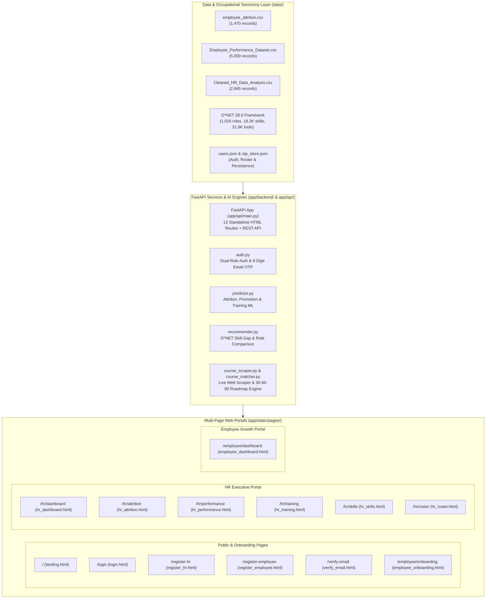

# PULSE // Enterprise AI People Analytics & Career Mobility Platform

An end-to-end Enterprise People Intelligence Platform that bridges executive workforce retention analytics with personalized O*NET career mobility, automated 30-60-90 day milestone roadmaps, and real-time course discovery across Coursera, edX, Udemy, and AWS.

Built as a high-performance **Multi-Page Application (MPA)** powered by a **FastAPI** backend, production **Scikit-Learn Machine Learning Pipelines**, dual-role authentication with **6-digit email OTP verification**, and a minimalist agency design system inspired by Fireart Studio.

---

## System Architecture



---

## Key Features & Capabilities

### 1. Dual-Role Authentication & 6-Digit Email OTP
* **HR Executive Registration**: HR Directors create an organization suite and are automatically issued a persistent company **HR Invite Code** (e.g. `HR-1049-ABCG`).
* **Employee Registration & Linking**: Employees register using their corporate HR Code, directly mapping them to their designated HR Director and department.
* **Email OTP Verification**: Two-step email verification via a 6-digit one-time passcode (`/verify-email`) stored securely with 10-minute expiry windows.
* **Employee Onboarding Wizard**: Step-by-step first-time onboarding (`/employee/onboarding`) capturing corporate branch office, department, current job role, target career promotion, and baseline competencies.

---

### 2. Machine Learning Predictive Intelligence
* **Workforce Attrition Diagnostics (`/hr/attrition`)**:
  * Predicts employee flight probability (0–100%) and categorizes risk into **Low, Medium, or High** tiers.
  * Diagnoses root burnout catalysts (e.g. mandatory overtime burdens, below-market compensation, career stagnation).
  * Interactive retention simulator to evaluate compensation adjustments.
* **360° Promotion & Performance Evaluation (`/hr/performance`)**:
  * Synthesizes quarterly KPI scores (35%), task velocity (25%), attendance (15%), and leadership peer reviews (15%) into an objective `ProductivityIndex`.
  * Predicts promotion readiness tier (*Immediate Promotion, Accelerated Track, Development Pathway*).
* **Training Outcome & ROI Forecaster (`/hr/training`)**:
  * Forecasts course completion likelihood and cost-per-training-day before assigning resources.

---

### 3. O*NET Career Mobility & Live Course Web Scraper
* **O*NET 28.0 Occupational Architecture (`/hr/skills`)**:
  * Search and compare competencies across **1,016 standard occupational profiles**, **18,200 skills**, and **31,821 software tools**.
  * Measures role-to-role competency overlap %, highlights missing critical skills, and flags in-demand **HOT TECH** tools.
* **Live Course Web Scraper Engine (`/hr/roster` & `POST /api/hr/scrape-courses`)**:
  * HR managers can query any topic (e.g. *Generative AI, Kubernetes Cloud Architecture, Strategic Negotiation, Financial Modeling*).
  * Scrapes real active courses live across **Coursera, edX, Udemy, and AWS** with verified enrollment links, partner universities, difficulty tiers, durations, and costs.
  * Direct 1-click assignment of scraped or catalog courses to employees.
* **Automated 30-60-90 Day Milestone Roadmaps**:
  * Automatically generates structured phased milestone checklists for career transitions.
  * Exportable as an official Markdown career development document.

---

### 4. Employee Growth Hub (`/employee/dashboard`)
* **Real Indicator Benchmarks**: Displays dynamic employee metrics (KPI Score, Task Velocity %, Attendance %, and Peer Review).
* **Initial Awaiting-Assignment State**: When an employee first logs in, courses and roadmap sections display an elegant pending review state until assigned by HR.
* **Course Catalog & Interactive Checklist**: Renders assigned courses with direct enrollment links and interactive 30-60-90 day milestone checklists.

---

### 5. Agency Minimalist Design & Abstract Vector Art
* **Light Theme Aesthetic**: Clean palette (`#FAFAFA` canvas, `#FFFFFF` cards, `#FF470A` flame accents, `#000000` text).
* **Layered Background SVGs**: Ambient dot-matrix blueprint grids and geometric floating mesh blocks across all 13 pages.
* **Zero Emojis on Interface Tokens**: Professional, typography-driven SaaS presentation.

---

## Multi-Page Route Directory

| URL Route | Page File | Purpose & Access Level |
| :--- | :--- | :--- |
| **`/`** | [`landing.html`](file:///d:/hrmsystem/app/static/pages/landing.html) | Public product landing page with ROI benchmarks and dual-role quick launch. |
| **`/login`** | [`login.html`](file:///d:/hrmsystem/app/static/pages/login.html) | Unified sign-in portal with automatic role-based redirect. |
| **`/register-hr`** | [`register_hr.html`](file:///d:/hrmsystem/app/static/pages/register_hr.html) | HR Executive registration & HR Code generator. |
| **`/register-employee`** | [`register_employee.html`](file:///d:/hrmsystem/app/static/pages/register_employee.html) | Employee registration linked via HR Invite Code. |
| **`/verify-email`** | [`verify_email.html`](file:///d:/hrmsystem/app/static/pages/verify_email.html) | 6-digit email OTP verification page. |
| **`/employee/onboarding`** | [`employee_onboarding.html`](file:///d:/hrmsystem/app/static/pages/employee_onboarding.html) | First-time profile wizard (Branch, Department, Role, Career Target). |
| **`/employee/dashboard`** | [`employee_dashboard.html`](file:///d:/hrmsystem/app/static/pages/employee_dashboard.html) | Employee Growth Hub, assigned courses, and 30-60-90 day roadmap. |
| **`/hr/dashboard`** | [`hr_dashboard.html`](file:///d:/hrmsystem/app/static/pages/hr_dashboard.html) | Executive KPI overview and workforce metrics. |
| **`/hr/attrition`** | [`hr_attrition.html`](file:///d:/hrmsystem/app/static/pages/hr_attrition.html) | Predictive attrition diagnostics and retention raise simulator. |
| **`/hr/performance`** | [`hr_performance.html`](file:///d:/hrmsystem/app/static/pages/hr_performance.html) | 360° performance radar and promotion readiness predictor. |
| **`/hr/training`** | [`hr_training.html`](file:///d:/hrmsystem/app/static/pages/hr_training.html) | Training program ROI analytics and completion forecaster. |
| **`/hr/skills`** | [`hr_skills.html`](file:///d:/hrmsystem/app/static/pages/hr_skills.html) | O*NET role-to-role gap comparator and curriculum builder. |
| **`/hr/roster`** | [`hr_roster.html`](file:///d:/hrmsystem/app/static/pages/hr_roster.html) | Team staff roster, target role modifier, and live web course scraper modal. |

---

## Directory & File Structure

```text
hrmsystem/
├── app/
│   ├── api/
│   │   ├── __init__.py
│   │   └── main.py                     # FastAPI server (13 HTML routes + REST API endpoints)
│   ├── backend/
│   │   ├── __init__.py
│   │   ├── auth.py                     # Dual-role authentication, OTP generator, onboarding logic
│   │   ├── config.py                   # Central directory & file path constants
│   │   ├── course_matcher.py           # 30-60-90 Day Roadmap synthesis & course catalog matcher
│   │   ├── course_scraper.py           # Live web scraper engine (Coursera, edX, Udemy, AWS)
│   │   ├── data_loader.py              # Cached dataset loader & KPI aggregator
│   │   ├── data_processor.py           # Automated ETL cleaning & feature engineering pipeline
│   │   ├── models_trainer.py           # Machine learning training & model serialization
│   │   ├── predictor.py                # Self-healing real-time inference engine
│   │   └── recommender.py              # O*NET 28.0 skill-gap & role comparison engine
│   ├── static/
│   │   ├── assets/
│   │   │   └── svg/
│   │   │       ├── auth-abstract-art.svg         # Authentication & security telemetry art
│   │   │       ├── bg-block-mesh.svg             # Ambient background gradient mesh
│   │   │       ├── bg-geometry-shapes.svg        # Ambient geometric shapes layer
│   │   │       ├── empty-state-waiting.svg       # Awaiting assignment orbital beacon
│   │   │       ├── hero-abstract-mesh.svg        # Hero header 3D isometric graphic
│   │   │       ├── retention-telemetry.svg       # Attrition risk probability curves
│   │   │       └── skill-matrix-geometry.svg     # 3D skill network illustration
│   │   ├── pages/                                # 13 Standalone HTML Page Views
│   │   │   ├── employee_dashboard.html
│   │   │   ├── employee_onboarding.html
│   │   │   ├── hr_attrition.html
│   │   │   ├── hr_dashboard.html
│   │   │   ├── hr_performance.html
│   │   │   ├── hr_roster.html
│   │   │   ├── hr_skills.html
│   │   │   ├── hr_training.html
│   │   │   ├── landing.html
│   │   │   ├── login.html
│   │   │   ├── register_employee.html
│   │   │   ├── register_hr.html
│   │   │   └── verify_email.html
│   │   ├── common.js                   # Universal auth guard, session manager & navbar renderer
│   │   ├── favicon.svg                 # Brand mark icon
│   │   └── styles.css                  # Fireart Studio design system & responsive layout tokens
│   └── tests/                          # Backend unit test suites
│       ├── test_data_pipeline.py
│       ├── test_models.py
│       └── test_recommender.py
├── data/
│   ├── external/                       # O*NET 28.0 raw taxonomy files
│   ├── processed/                      # Cleaned, feature-engineered CSV files
│   ├── raw/                            # Baseline enterprise employee datasets
│   ├── otp_store.json                  # Active email OTP verification codes
│   └── users.json                      # Seeded demo accounts & persistent user profiles
├── models/                             # Pre-trained ML serialized pipelines (.joblib)
│   ├── attrition_model.joblib
│   ├── performance_model.joblib
│   └── training_model.joblib
├── notebooks/                          # Jupyter exploration & data science notebooks
├── .dockerignore                       # Production Docker build exclusions
├── .gitignore                          # Git repository ignore rules
├── Dockerfile                          # Multi-stage production container configuration
├── Procfile                            # Process configuration for Railway & Heroku
├── render.yaml                         # 1-Click deployment blueprint for Render.com
├── requirements.txt                    # Pinned production Python dependencies
├── run_server.py                       # Production ASGI server launcher (binds to cloud $PORT)
└── run_tests.py                        # Complete 13-test automated validation suite
```

---

## Quick Start & Local Development

### 1. Prerequisites
* Python 3.10+ installed.

### 2. Installation
```bash
# Clone the repository
git clone https://github.com/harmandugri15/HRMSystem.git
cd HRMSystem

# Install dependencies
pip install -r requirements.txt
```

### 3. Run the Automated Test Suite (13/13 Tests)
```bash
python run_tests.py
```

### 4. Launch the Production Server
```bash
python run_server.py
```
Open your browser at **`http://localhost:8000`**.

---

## Demo Credentials for Instant Evaluation

| Role | Email | Password | Access Rights |
| :--- | :--- | :--- | :--- |
| **HR Director** | `hr@pulse.ai` | `HR@123` | Executive Analytics, Attrition Lab, Performance Radar, Roster & Course Assigner |
| **Employee** | `alex@pulse.ai` | `Emp@123` | Employee Growth Hub, Benchmark KPIs, Assigned Courses, 30-60-90 Roadmap |

*(You can also use the **"Create HR Account"** or **"Register as Employee"** forms to test fresh 6-digit OTP verification and onboarding).*

---

## Production Cloud Deployment

The repository includes pre-configured infrastructure files for 1-click cloud deployments:

### Deploy to Render.com
1. Connect your repository on [dashboard.render.com](https://dashboard.render.com).
2. Create a new **Web Service**.
3. Render automatically reads [`render.yaml`](file:///d:/hrmsystem/render.yaml) or you can specify:
   * **Build Command**: `pip install -r requirements.txt`
   * **Start Command**: `python run_server.py`
4. The service will build and provide a live HTTPS domain in under 2 minutes.

### Deploy with Docker
```bash
# Build the container image
docker build -t pulse-hrms .

# Run the container
docker run -p 8000:8000 pulse-hrms
```
Access at `http://localhost:8000` or your server's public IP address.

---

## Tech Stack

* **Backend & API**: Python 3.12, FastAPI, Uvicorn, Pydantic, HTTPX
* **Machine Learning**: Scikit-Learn (Random Forest Pipelines, ColumnTransformers, Probability Calibration), Joblib
* **Data Processing**: Pandas, NumPy
* **Frontend**: Multi-Page Architecture (HTML5, Vanilla ES6+ JavaScript, CSS3 Design Tokens)
* **Occupational Standard**: O*NET 28.0 Database (U.S. Department of Labor)
* **Course Catalog & Discovery**: Live scraping across Coursera, edX, Udemy, AWS
* **Containerization & CI/CD**: Docker, GitHub Actions, Render Infrastructure-as-Code
